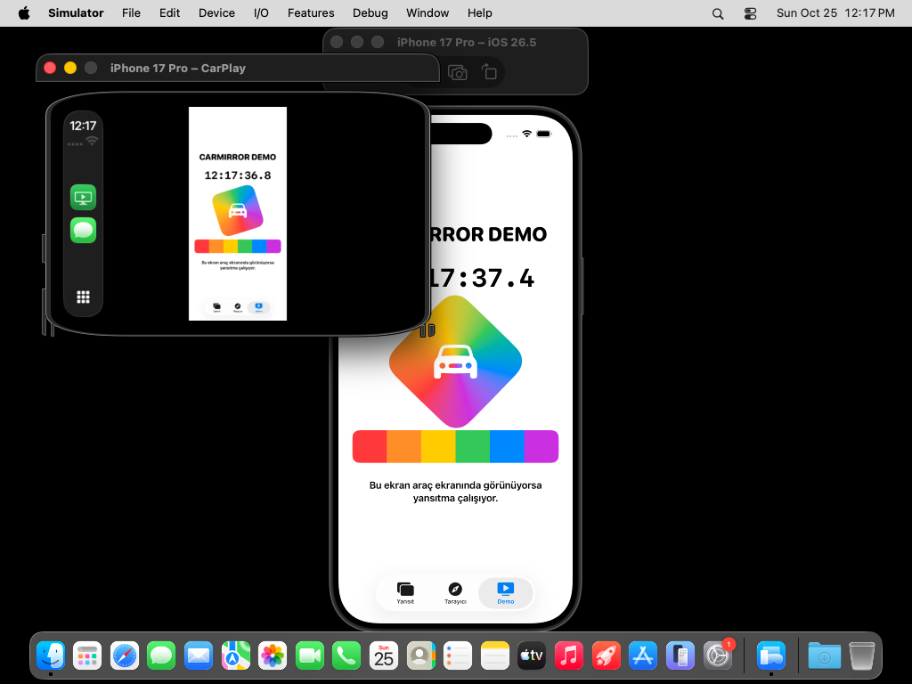

# CarMirror

[](https://github.com/omernasuhi/CarMirror/actions/workflows/ci.yml)

iPhone ekranını gerçek zamanlı olarak Apple CarPlay ekranına yansıtan ve araçta sesli bir yapay
zekâ asistanı (Alfred) sunan iOS uygulaması.

- **Asistan:** Uygulama açılır açılmaz (ve CarPlay'de CarMirror açılınca) Alfred sizi karşılar:
  *"İyi akşamlar efendim. Nereye gidiyoruz?"* Konuşursunuz, Claude cevaplar, cümle cümle
  seslendirilir. "Kadıköy'e gidelim" deyince Apple Haritalar'da rotayı başlatır.
- **Gerçek cihazda:** Uygulamada **Ekran Yayınını Başlat**'a dokunup iOS'un *Screen Broadcast*
  penceresinde **Start Broadcast**'e basınca, telefonda ne açarsanız araç ekranında görünür.
- **Simülatörde:** iOS simülatörü ekran yayınını (ReplayKit) desteklemez. Bu yüzden uygulama kendi
  ekranını yansıtır (Yansıt, Tarayıcı ve Demo sekmeleri). CarPlay ekranında CarMirror açılınca bu
  yansıtma kendiliğinden başlar.

## Simülatörde çalıştırma

> **Xcode sürümü önemli.** CarPlay ekranı yalnızca **Xcode 26** ve öncesindeki Simulator
> uygulamasında var. Xcode 27'de Simulator'ın yerini alan Device Hub, simülatörler için CarPlay
> ekranı sunmuyor (Apple bunu bilinen sorun olarak listeliyor). Xcode 27 kullanıyorsanız aşağıdaki
> [Xcode 27 kullanıyorsanız](#xcode-27-kullanıyorsanız) bölümüne bakın.

1. Repoyu indirin ve `CarMirror.xcodeproj` dosyasını **Xcode 26** ile açın.
2. Üstteki hedef seçicide bir iPhone simülatörü seçin (ör. *iPhone 17 Pro*) ve **Run** (⌘R) ile
   çalıştırın. Simülatör için geliştirici hesabı veya takım seçmek gerekmez.
3. Simulator menüsünden **I/O → External Displays → CarPlay**'i seçin. CarPlay ekranı ayrı bir
   pencerede açılır.
4. CarPlay penceresinde **CarMirror** simgesine tıklayın.
5. iPhone simülatörünün ekranı CarPlay penceresinde görünür. Telefonda **Demo** sekmesine geçip
   hareketli test ekranını, **Tarayıcı** sekmesinden de web sitelerini araç ekranında izleyebilirsiniz.



*GitHub Actions'taki uçtan uca testten (Xcode 26.6, iPhone 17 Pro, iOS 26.5): solda CarPlay
ekranı, sağda iPhone simülatörü. CarPlay ekranındaki saat telefondakiyle birlikte ilerler.*

CarPlay penceresinin üst çubuğundaki **Doldur / Sığdır** düğmesi görüntüyü ekranı dolduracak
şekilde büyütür ya da tamamını gösterir. Üst çubuk birkaç saniye sonra kendiliğinden gizlenir;
görmek için CarPlay ekranına dokunun.

### iOS 26.4 / 26.5 simülatöründeki Apple hatası (otomatik düzeltilir)

Bu simülatör sürümlerinde CarPlay'in sistem süreci (`CarPlayTemplateUIHost`), herhangi bir
navigasyon uygulaması harita şablonu gösterdiğinde eksik bir yöntem yüzünden çöküyor. Ekranda
*"CarPlayTemplateUIHost quit unexpectedly"* uyarısı çıkar ve CarPlay ana ekrana döner. Gerçek
cihazlar etkilenmez
([ayrıntılar](https://github.com/organicmaps/organicmaps/pull/13507)).

CarMirror şeması bunu kendisi düzeltir: Xcode'da **Run**'a bastığınızda, ön eylem olarak
`scripts/carplay-sim-shim/install.sh` çalışır. Bu betik eksik yöntemleri ekleyen küçük bir
kütüphaneyi derleyip simülatöre yükler ve sonucu `/tmp/carmirror-carplay-shim.log` dosyasına yazar.
Yama yalnızca simülatörü etkiler. Kaldırmak için:

```sh
xcrun simctl spawn booted launchctl unsetenv DYLD_INSERT_LIBRARIES
```

Uygulamayı Xcode dışında başlattıysanız yamayı elle de yükleyebilirsiniz:
`scripts/carplay-sim-shim/install.sh`.

### Xcode 27 kullanıyorsanız

Xcode 27'nin Device Hub'ında simülatör için CarPlay ekranı açılamıyor. İki seçenek var:

- **Xcode 26.6'yı yanına kurun** (önerilen). <https://developer.apple.com/download/all/>
  adresinden *Xcode 26.6*'yı indirip örneğin `Xcode-26.6.app` adıyla Uygulamalar klasörüne koyun.
  Projeyi bu Xcode ile açıp yukarıdaki adımları izleyin. İki Xcode sürümü yan yana çalışabilir.
- **Gerçek iPhone + CarPlay Simulator uygulaması:** Xcode'un *Additional Tools* paketindeki
  bağımsız CarPlay Simulator, USB ile bağlı gerçek bir iPhone'la çalışır. Bunun için aşağıdaki
  CarPlay yetkisi gerekir.

## Gerçek iPhone ve araçta kullanma

1. Proje ayarlarında (**CarMirror** projesi → **Build Settings** → *User-Defined*):
   - `DEVELOPMENT_TEAM`: Team ID'niz (ya da her hedefte **Signing & Capabilities** → *Team*).
     App Group kullanıldığı için ücretli Apple Developer Program üyeliği gerekir.
   - `BUNDLE_ID_PREFIX`: varsayılanı `com.omernasuhi`; başka bir hesapla imzalıyorsanız kendi
     ters alan adınızla değiştirin.

   App Group (`group.<BUNDLE_ID_PREFIX>.carmirror`) ve yayın eklentisinin kimliği bu
   değerlerden otomatik türetilir.
2. **CarPlay yetkisi:** CarPlay'de kendi görüntüsünü çizebilen tek uygulama türü navigasyon
   uygulamalarıdır. Bu yüzden CarMirror kendini navigasyon uygulaması olarak tanıtır
   (`com.apple.developer.carplay-maps`). Bu yetkiyi Apple
   <https://developer.apple.com/contact/carplay/> üzerinden onaylar.
   - Onay gelene kadar gerçek cihaz derlemesi bu yetki olmadan imzalanır
     (`CARMIRROR_DEVICE_ENTITLEMENTS = App/CarMirror-NoCarPlay.entitlements`). Böylece Xcode
     imzalama hatası vermez; uygulama ve ekran yayını telefonda çalışır, ama araç ekranında
     CarMirror görünmez.
   - Apple onaylayınca aynı ayarı `App/CarMirror.entitlements` yapın.
   - Simülatör her zaman yetkili dosyayı kullanır; onay gerekmez.
3. Uygulamayı iPhone'a yükleyin, iPhone'u araca (CarPlay) bağlayın ve araç ekranında CarMirror'ı
   açın.
4. Telefonda **Ekran Yayınını Başlat**'a, açılan pencerede **Start Broadcast**'e dokunun.

Apple ekran yansıtma amaçlı uygulamalara bu yetkiyi vermediği için uygulama bu haliyle App Store
incelemesinden geçmez; kişisel kullanım ve geliştirme içindir.

## Sesli asistan (Alfred)

Batman'in uşağı Alfred'in zarafeti ile usta bir barmenin rahatlığını birleştiren araç içi asistan.
Telefonda **Asistan** sekmesinde, CarPlay'de ise pencerenin kendisi olarak görünür; iki ekran aynı
sohbeti gösterir. Ortadaki çekirdek konuşmaya ve sese tepki verir (dinlerken mavi, düşünürken mor,
konuşurken altın).

### Kurulum

1. Telefonda **Asistan** sekmesinde dişli simgesine dokunun.
2. **Anthropic API anahtarı**nı girin (<https://console.anthropic.com>). Anahtar yalnızca cihazın
   anahtar zincirinde saklanır ve doğrudan Anthropic'e gönderilir. Varsayılan model Claude Opus 5.5;
   daha hızlı cevap için Sonnet 5.5 ya da Haiku 5.5 seçilebilir.
3. **Ses:** Apple'ın cihaz içi sesi ücretsizdir ve anahtar gerektirmez. Daha doğal bir ses için
   **ElevenLabs** seçip API anahtarınızı girin ve **Hesabımdaki sesleri getir** ile bir ses seçin
   (Türkçe için `eleven_flash_v2_5` modeli kullanılır).
4. İlk konuşmada iOS mikrofon ve konuşma tanıma izni ister.

Geliştirirken anahtarları Xcode şemasının ortam değişkenleriyle de verebilirsiniz:
`CARMIRROR_ANTHROPIC_API_KEY`, `CARMIRROR_ELEVENLABS_API_KEY`, `CARMIRROR_ELEVENLABS_VOICE_ID`.
Anahtarları asla depoya yazmayın.

### Kullanım

- Asistan karşılamayı bitirince dinlemeye başlar; susunca cevap verir, cevaptan sonra yine dinler.
  Sessizlikte bekleme moduna geçer; konuşmak için çekirdeğe ya da mikrofon düğmesine dokunun.
- Konuşurken sözünü kesmek için çekirdeğe dokunun.
- Simülatörde mikrofon yoksa klavye simgesiyle yazarak sorabilirsiniz.
- Navigasyon: "Kadıköy'e gidelim", "yakında benzinlik var mı" gibi isteklerde Apple Haritalar açılır
  (CarPlay bağlıyken araç ekranında).
- Ayarlardan asistanın adı, hitabı ("efendim", "patron"…) ve adınız değiştirilebilir.

### Nasıl çalışır?

```
Mikrofon → SFSpeechRecognizer (cihaz içi, Türkçe) → metin
       → Claude Messages API (akışlı, araç çağrıları: start_navigation, search_places)
       → cümle cümle → Apple TTS veya ElevenLabs → araç hoparlörü
```

Cevaplar akış halinde gelir; ilk cümle tamamlanır tamamlanmaz okunmaya başlar. Konuşma geçmişi
(thinking blokları dahil) bir sonraki isteğe değiştirilmeden gönderilir; Claude Opus/Sonnet'te
güvenlik sınıflandırıcısı bir isteği reddederse sunucu taraflı yedek model (`fallbacks: "default"`)
devreye girer.

**Maliyet:** Her cevap kısa tutulur (1–2 cümle). Opus 5.5 ile tipik bir soru-cevap birkaç bin giriş
tokeni ve ~50 çıkış tokenidir; ElevenLabs karakter başına ücretlendirir.

**Güvenlik:** Asistan sürüş sırasında dikkati dağıtmayacak şekilde kısa konuşur ve tehlikeli sürüş
isteklerini geri çevirir. Yine de telefon ekranıyla ilgilenmeyin; konuşarak kullanın.

## Nasıl çalışır?

```
 Gerçek cihaz                                Simülatör
 ────────────                                ─────────
 iPhone ekranı (ReplayKit)                   Uygulamanın kendi penceresi
        │ BroadcastExtension                        │ InAppMirror (drawHierarchy)
        ▼                                           ▼
 H.264 donanım kodlama (VideoToolbox)        H.264 kodlama (VideoToolbox)
        │ App Group içindeki Unix soketi            │ aynı süreç içinde
        └──────────────────────┬────────────────────┘
                               ▼
                 MirrorReceiver (CarMirror uygulaması)
                               ▼
         AVSampleBufferDisplayLayer → CarPlay penceresi (CPWindow + CPMapTemplate)
```

| Klasör | İçerik |
| --- | --- |
| `App/` | Ana uygulama: telefon arayüzü (SwiftUI), CarPlay sahnesi, alıcı, uygulama içi yansıtma |
| `BroadcastExtension/` | ReplayKit yayın eklentisi: ekran karelerini alıp kodlar ve sokete gönderir |
| `Shared/` | İki hedefin ortak kodu: H.264 kodlayıcı, soket istemcisi, paket biçimi, ayarlar |
| `Tests/CarMirrorTests/` | Birim ve uçtan uca testler |
| `scripts/` | Proje dosyası üreticisi ve CI betikleri |

## Testler

Xcode'da **Product → Test** (⌘U) ile çalıştırılır. Testler şunları doğrular:

- Paket biçiminin yazılıp okunması
- H.264 kodlayıcının anahtar kare, SPS/PPS ve doğru boyut üretmesi
- Yayın eklentisinin yolu: kodlayıcı → Unix soketi → alıcı → VideoToolbox ile çözme
  (çözülen görüntünün rengi kaynakla karşılaştırılır), anahtar kare isteği ve yeniden bağlanma
- CarPlay görünümünün kareleri `AVSampleBufferDisplayLayer` ile göstermesi ve yan çevrilmiş
  telefonda görüntüyü döndürmesi
- Uygulama içi yansıtmanın ekranı yakalayıp iletmesi ve ekran yayını başlayınca durması
- Asistan: cümle bölme, Claude akış ayrıştırma (thinking imzası, araç çağrısı), istek biçimi
  (sahte sunucuyla), motorun karşılama → dinleme → cevap → navigasyon akışı (sahte beyin ve sesle)

GitHub Actions her gönderimde testleri Xcode 26.6 ve Xcode 27 ile çalıştırır ve uygulamayı
gerçek iPhone için de derler. Ayrıca iPhone simülatöründe CarPlay ekranını açıp CarMirror'a
dokunur ve telefonun Demo ekranının CarPlay ekranında göründüğünü ekran görüntüsündeki yazıdan
doğrular. Son çalıştırmanın ekran görüntüleri
[`ci-ekran-goruntuleri`](https://github.com/omernasuhi/CarMirror/tree/ci-ekran-goruntuleri)
dalındadır.

## Bilinen sınırlamalar

- **DRM içerik:** Netflix, Apple TV+ ve benzeri korumalı içerikler iOS tarafından ekran kaydına
  kapatılmıştır ve siyah görünür.
- **Ses:** Ses aktarılmaz; CarPlay bağlıyken telefonun sesi zaten aracın hoparlörlerinden çalar.
  Görüntüde 100–200 ms civarı gecikme olabilir.
- **Yatay görüntü:** Telefon yan çevrildiğinde görüntü CarPlay tarafında döndürülür. Görüntü baş
  aşağı çıkarsa telefondaki **Yatay görüntüyü ters çevir** ayarını açın.
- **Uygulama içi yansıtma** yalnızca CarMirror'ın kendi ekranını gösterir ve uygulama ön plandayken
  çalışır. Tüm ekran için gerçek cihazda ekran yayınını kullanın.
- **CarPlay'de başka uygulamaya geçilirse** CarMirror askıya alınabilir ve görüntü durur;
  CarMirror'a dönülünce devam eder.

## Proje dosyasını yeniden üretme

`CarMirror.xcodeproj`, `scripts/generate-project.rb` ile üretilir. Yeni dosya ekledikten sonra:

```sh
gem install xcodeproj
ruby scripts/generate-project.rb
```

## Güvenlik

Araç hareket halindeyken araç ekranında video oynatmak tehlikelidir ve birçok ülkede yasaktır.
Uygulamayı yalnızca araç park halindeyken kullanın.
